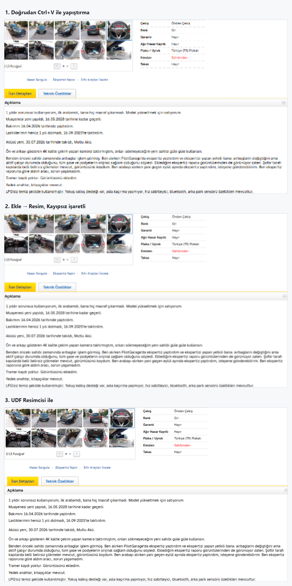

# UDF Resimcisi

### [⬇ Windows için indir (UDF-Resimcisi-kurulum.exe)](https://github.com/SCgrS/UDF-Resimcisi/releases/latest/download/UDF-Resimcisi-kurulum.exe)

Bir fotoğrafı, taranmış bir sayfayı ya da ekran görüntüsünü **ideal çözünürlükte, kalitesini koruyarak** `.udf` belgesine
koyan bir Windows uygulaması.

Belge UYAP Doküman Editörü'nde (UDE) açılır, oradan kopyalayıp dilekçelere yapıştırılabilir. Belgeyi tek başına da
kullanabilirsiniz: `.udf` dosyası UYAP'a doğrudan yüklenebilir.

Uygulama okunmaz resim sorununu çözer. UDE bir resmi **Ekle › Resim** yoluyla belgeye alırken onu sayfadaki görüntüleme
boyutuna, yaklaşık 72 DPI'a küçültür: 3000 × 2000 piksellik bir tarama belgeye 524 × 349 piksel olarak girer, ince yazılar
okunmaz olur. Ekleme penceresindeki **Kayıpsız** seçeneği bunu değiştirmez. UDF Resimcisi `.udf` dosyasını kendisi yazdığı
için o küçültme hiç çalışmaz.

> Bu uygulama UYAP ile ilişkili değildir. Yalnızca birlikte çalışabilirlik için UDF dosyası üretir, UDE'ye ait hiçbir kod
> içermez.

## Kurulum

Windows 10 ve üzeri, 64 bit. Yönetici hakkı gerekmez. UYAP Doküman Editörü kurulu olmalıdır: Uygulama belgeyi UDE'de açar.
UDE'yi kendisi bulur. Kurulu olduğu hâlde bulamazsa bunu söyler, belge üretmez ve **UDE'nin yerini göster** düğmesini
gösterir. Bu düğmeyle `Uyap Doküman Editörü.exe` dosyasını bir kez seçmeniz yeter (genellikle
`C:\Uyap\Uyap Kelime Islemci` klasöründedir).

1. Yukarıdaki bağlantıdan `UDF-Resimcisi-kurulum.exe` dosyasını indirin (tek dosya, 2 MB) ve çift tıklayın.
2. Windows SmartScreen uyarı gösterirse **Daha fazla bilgi**'ye, sonra **Yine de çalıştır**'a basın. Uyarı, dosya imzalı
   olmadığı için çıkar. Kod imzalama sertifikası olmadığından her yeni sürümde yeniden çıkar.
3. Kurulum birkaç saniye sürer. Bitince Başlat menüsünden **UDF Resimcisi**'ni açın.

Kurulum sistem klasörlerine bir şey yazmaz:

- Uygulama `%LOCALAPPDATA%\UDF Resimcisi` klasörüne kopyalanır.
- Başlat menüsüne **UDF Resimcisi** kısayolu eklenir.
- Windows'un "Uygulamalar ve özellikler" listesine kaydedilir.

Kurulum istemiyorsanız [Sürümler sayfasında](https://github.com/SCgrS/UDF-Resimcisi/releases) iki seçenek daha var:

- `UDF-Resimcisi-tasinabilir.exe` (5 MB): İndirin, çift tıklayın, çalışır. Hiçbir şey kurmaz, `.exe` dosyasını silmeniz
  yeterlidir. Ayar dosyası ve belge listesi `%APPDATA%\UDF Resimcisi` klasöründe kalır.
- `UDF-Resimcisi-x64.msi` (3 MB): Kurumsal dağıtım için.

## Öne çıkanlar

- **Okunur resim:** Resim ekrandaki hâliyle, piksel piksel belgeye girer. UDE'nin küçültmesi hiç devreye girmez.
- **İdeal Boyut:** Varsayılan basamak, gözle görülür fark bırakmadan dosyayı 10 kata kadar küçültür. **Orijinal Boyut**
  seçilirse PNG ve JPEG girdilerinde tek bir bayt bile değiştirilmez.
- **Kolay ekleme:** Resimler pencereye sürüklenir, **Dosya seç** ile seçilir ya da panodan **Ctrl+V** ile yapıştırılır.
  Ekran görüntüsü tek tuşla, saniyeler içinde belge olur.
- **Gerçek dosya boyutu:** Resimler eklendikçe üretilecek dosyanın boyutu gerçekten hesaplanıp gösterilir. Dilekçeye
  yapıştırıldığında kaplayacağı yer de yazar.
- **Telefon fotoğrafları:** EXIF yön bilgisi okunur. Gerekiyorsa resim kayıpsız PNG'ye çevrilip düzeltilir.
- **Birden çok resim:** Hepsi tek belgeye girer, araya boş satır ya da sayfa sonu konur.
- **Kendini günceller:** Yeni sürüm çıktığında haber verir ve tek tıkla kendini günceller.

## Ne yapar

### Resimden belgeye

1. Resimleri pencereye sürükleyin ya da **Dosya seç**'e basın. Panoda bir resim varsa (örneğin `Win+Shift+S` ile alınmış
   ekran görüntüsü) **Ctrl+V** ile veya pencerede sağ tıklayıp **Yapıştır** ile ekleyin.
2. Kalite listesinde **İdeal Boyut** seçili gelir, çoğu iş için değiştirmeniz gerekmez. Bir resmi farklı kalitede
   istiyorsanız listedeki satırının yanındaki seçimden ayarlayın. Alttaki liste bu durumda kendiliğinden **Özel** yazar.
   Alttaki listeden bir basamak seçmek bütün resimleri o basamağa getirir ve tek tek yapılan ayarları siler.
3. **UDF'de aç**'a basın. Belge kaydetme klasörüne yazılır ve UDE'de açılır.
4. UDE'de **Ctrl+A** ile tümünü seçin, **Ctrl+C** ile kopyalayın. Dilekçenizi açıp istediğiniz yere **Ctrl+V** ile
   yapıştırın.

### UDE'nin resim ekleme yollarıyla karşılaştırma

Aynı ekran görüntüsünü (bir ilan sayfası) dilekçeye üç yolla koyduk. Aşağıda üçü de UDE'de aynı büyütmede görünüyor:

1. **Doğrudan yapıştırma.** Ekran görüntüsü veya kopyalanan bir fotoğraf UDE'de **Ctrl+V** ile yapıştırılınca UDE resmi
   küçültür. Sonuç en kötüsüdür: Yazılar okunmaz, fotoğrafların kalitesi aşırı düşer.
2. **Ekle › Resim, Kayıpsız işaretli.** Bir görüntüyü UDE'nin **Ekle › Resim** penceresinden **Kayıpsız** seçeneğiyle
   eklemek biraz daha iyi sonuç verir. Ama küçültme yine çalışır, yazılar yine bulanık olur. Ayrıca ekran görüntülerini
   Paint'e yapıştırıp kaydetmek ve UDE'nin ekleme penceresindeki klasörlerden eklemek ya da aynı pencerede Ekran
   Görüntüleri klasörünü bulup eklemek zahmetlidir.
3. **UDF Resimcisi.** Ekran görüntüleri **Ctrl+V** ile ya da sağ tık › **Yapıştır** ile doğrudan programa yapıştırılır,
   belge tek tuşla saniyeler içinde oluşur. Görüntüler pencereye sürüklenebilir ya da kopyalanıp aynı şekilde
   yapıştırılabilir. Uygulama belgeyi kendisi yazdığı için küçültme hiç devreye girmez. Resim ekrandaki hâliyle, piksel
   piksel belgeye girer.

  

Bu yalnızca ekran görüntülerinde değil, her resimde böyledir: Taranmış sayfa, telefon fotoğrafı, ekspertiz raporu. UDE'nin
kendi yollarıyla giren resim her zaman ekran çözünürlüğüne düşer. UDF Resimcisi'yle giren resim olduğu gibi kalır.

### Kalite basamakları

Listedeki basamaklar dosyanın büyüklüğünü belirler. **Bu bir ölçek ayarı değildir:** Resim her basamakta sayfada aynı
yeri kaplar, yalnızca içindeki piksel yoğunluğu (ayrıntı) azalır. Her resmin kalitesi ayrı ayrı da seçilebilir.

| Seçenek | Belgeye giren bitmap (3000 × 2000 px girdi için) |
| --- | --- |
| **Orijinal Boyut** | 3000 × 2000 px. Baytlara hiç dokunulmaz. |
| **İdeal Boyut** (varsayılan) | 1574 × 1049 px. Punto başına 3 piksel, sayfada ≈ 216 DPI. |
| **Orta Boyut** | 1050 × 700 px |
| **Küçük Boyut** | 526 × 350 px. UDE'nin kendi **Ekle › Resim** çıktısıyla (524 × 349) eş değer. |

Tek bir pikselin bile korunması gerekiyorsa **Orijinal Boyut**'u seçin. Dilekçe 10 MB sınırına yaklaşıyorsa bir basamak
inin. Sayfaya zaten sığan küçük resimler hiçbir basamakta değiştirilmez, büyütme yapılmaz. Ekran görüntülerinde İdeal Boyut
zaten küçük olan orijinali büyütmez, orijinal olduğu gibi kalır.

#### İdeal Boyut ile Orijinal Boyut arasında fark var mı?

Gözle görülür bir fark yok. Belgede ikisi de aynı yeri kaplar. Değişen yalnızca içindeki piksel sayısı ve dosya boyutudur.
Ölçülmüş dosya boyutları (ölçüm aracı ve yöntem [DOGRULAMA.md](DOGRULAMA.md) içinde):

| Girdi | Basamak | Belgeye giren resim | `.udf` dosyası | Dilekçeye yapıştırıldığında |
| --- | --- | --- | --- | --- |
| 12 MP telefon fotoğrafı (4000 × 3000, 3,5 MB JPEG) | Orijinal Boyut | 4000 × 3000 px | 3,55 MB | ≈ 13,4 MB |
| | **İdeal Boyut** | 1575 × 1181 px | **300 KB** | ≈ 1,6 MB (ölçüldü: 1,65 MB) |
| | Orta Boyut | 1050 × 788 px | 68 KB | ≈ 0,5 MB |
| | Küçük Boyut | 526 × 395 px | 13 KB | ≈ 0,1 MB |
| Taranmış A4 sayfa (2480 × 3508, 300 DPI, 1,9 MB JPEG) | Orijinal Boyut | 2480 × 3508 px | 1,93 MB | ≈ 7,7 MB |
| | **İdeal Boyut** | 1574 × 2227 px | **777 KB** | ≈ 2,8 MB |
| | Orta Boyut | 1050 × 1485 px | 250 KB | ≈ 1,0 MB |
| | Küçük Boyut | 525 × 743 px | 60 KB | ≈ 0,2 MB |

#### Yapıştırınca dosya neden büyüyor?

Son sütun önemli: UDE, panodan yapıştırılan **her resmi PNG olarak yeniden kodlar**, bizim dosyada JPEG olsa bile. Bu
yüzden dilekçenizin büyüyeceği miktar `.udf` dosyasının boyutu değil, resmin **piksel sayısıdır**. 300 KB'lık İdeal Boyut
belgesi dilekçeye yaklaşık 1,6 MB olarak girer. Orijinal Boyut'taki aynı fotoğraf 13 MB'a çıkıp UYAP'ın yaklaşık **10 MB**
evrak sınırını aşar. Word'den çevrilen belgelerde de resim genellikle benzer piksel sayısıyla PNG olarak gömüldüğü için iki
yol aynı büyüklükte çıkabilir. Fark, resmin okunabilirliğinde ve `.udf` dosyasını doğrudan yüklediğinizde ortaya çıkar.

Uygulama iki sayıyı da gösterir: Kalite listesinin altındaki satırda üretilecek dosyanın boyutu ve dilekçeye
yapıştırıldığında yaklaşık ne kadar yer tutacağı yazar.

### Eklenen resimler ve belge

- Desteklenen girdiler: PNG, JPEG, WEBP, BMP, TIFF, GIF. PNG ve JPEG olduğu gibi gömülür. WEBP, BMP, TIFF ve GIF, UDE'nin
  tanımadığı biçimler olduğu için kayıpsız PNG'ye çevrilir. Çevirme kayıpsızdır ama dosya boyutu değişebilir. GIF'lerin
  yalnızca ilk karesi alınır.
- Eklenen her resim listede piksel ölçüsü, sayfadaki boyutu (cm), biçimi ve dosya boyutuyla görünür. Yanındaki **Kaldır**
  ile çıkarılır, **Tümünü kaldır** listeyi boşaltır.
- Her satırda o resmin kalite seçimi ve altında **Belgede: …** yazısı vardır: Resmin seçilen kalitede belgeye gireceği
  boyut. Hangi resmi küçültmenin işe yarayacağı buradan görülür. Yeni eklenen resim alttaki listedeki basamağı alır
  (alttaki liste **Özel** gösterirken en son seçilen genel basamağı).
- Aynı resim birden çok kez eklenebilir. Resimler belgeye eklediğiniz sırayla girer.
- Dosya adı ilk resmin adından türetilir (`tarama.png` → `tarama.udf`). Panodan gelen resimlerde
  `resimler-YYYYAAGG-SSDD.udf` olur. Aynı ad varsa ` (2)`, ` (3)` eklenir.
- Kalite listesinin altındaki üretilecek dosya boyutu satırı tahmin değildir: Belge gerçekten kurulup ölçülür, her ekleme
  ve kalite değişiminde yenilenir. Yanındaki "dilekçeye yapıştırıldığında" değeri ise UDE'nin PNG kodlamasının
  kestirimidir. Ölçümlerde gerçek değerin %2 üstünde çıktı.
- Büyük düğmenin altındaki **Klasörü aç**, kaydetme klasörünü Gezgin'de açar. Az önce bir belge ürettiyseniz o dosya seçili
  gelir.
- Bellek: Boşta yaklaşık 70 MB. Pencere simge durumuna küçültülünce ya da 30 saniye arka planda kalınca arayüzün belleğini
  kısar (yaklaşık 55 MB), öne gelince eski hâline döner. Ölçümler için bkz. [DOGRULAMA.md](DOGRULAMA.md) "1.7.1 sürümü —
  bellek".

### Ayarlar

Sağ üstteki çark düğmesi **Ayarlar** penceresini açar. Her değişiklik anında kaydedilir. Ayarlar penceresi açıkken
**Ctrl+V** ve sağ tık menüsü çalışmaz.

| Satır | Ne yapar |
| --- | --- |
| **Tema** | **Sistem**, **Açık** ya da **Koyu**. Sistem, Windows'un tema ayarını izler. |
| **Sayfa düzeni › Her resim ayrı sayfada** | Kapalıyken (varsayılan) resimler arasına bir boş satır konur. Açıkken her resim yeni sayfaya geçer. |
| **Kaydetme klasörü › Değiştir** | Belgelerin yazıldığı klasör. Varsayılan `Belgelerim\UDF Resimcisi`. |
| **Güncelleme › Açılışta yeni sürümü denetle** | Açıkken (varsayılan) uygulama her açılışta son sürümü sorar ve yeni sürüm varsa şerit gösterir. |
| **Güncelleme › Şimdi denetle ve güncelle** | Hemen sorar. Yeni sürüm varsa indirip kurar ve uygulamayı yeniden açar. |

Pencerenin altında 10 MB hatırlatması, kalite basamakları hakkında kısa bir not, sürüm numarası ve geliştirici bağlantısı
bulunur.

## Güncelleme

Uygulama kendini günceller. Her açılışta GitHub'dan son sürümü sorar. Yeni sürüm varsa pencerenin üstünde bir şerit çıkar.
**Güncelle**'ye bastığınızda kurulum dosyası indirilir, kısa bir ilerleme penceresiyle kurulur ve uygulama yeni sürümüyle
yeniden açılır. Ayarlarınıza dokunulmaz. **Daha sonra** derseniz şerit kapanır, bir sonraki açılışta yeniden hatırlatılır.

Beklemek istemiyorsanız **Ayarlar › Güncelleme › Şimdi denetle ve güncelle** aynı işi hemen yapar. Açılıştaki denetimi
**Ayarlar › Güncelleme › Açılışta yeni sürümü denetle** kutusundan kapatabilirsiniz. O zaman yalnızca düğmeye bastığınızda
sorulur.

## Veri gizliliği

Belge üretimi tamamen yereldir. Resimleriniz hiçbir yere gönderilmez, telemetri yoktur.

- Ayarlar: `%APPDATA%\UDF Resimcisi\ayarlar.json`. UDE'nin yerini elle gösterdiyseniz o yol da burada durur.
- Üretilen belgeler: Seçtiğiniz kaydetme klasörü (varsayılan `Belgelerim\UDF Resimcisi`). Uygulama ürettiği her belgenin
  yolunu, boyutunu ve kayıt zamanını `%APPDATA%\UDF Resimcisi\uretilenler.json` dosyasına yazar. Kaldırıcı yalnızca bunları
  siler (aşağıda).
- Kayıt defteri: Uygulama artık bir şey yazmaz. 1.7.2'ye kadar yazılan `HKCU\Software\UDF Resimcisi` anahtarını kaldırıcı
  siler.
- Ağ: Yalnızca sürüm denetiminde `api.github.com`'a tek bir sorgu gider: Açılışta (kapatılabilir) ve düğmeye
  bastığınızda. Güncelle derseniz kurulum dosyası GitHub'dan `%TEMP%\UDF Resimcisi` altına indirilip çalıştırılır. Resimleriniz ağa hiçbir
  zaman çıkmaz.

Uygulamayı kaldırırken kaldırıcıdaki **Uygulama verilerini sil** kutusunu işaretlerseniz ayarlar ve uygulamanın ürettiği
belgeler de silinir. Yalnızca uygulamanın kendi ürettiği ve o günden beri değişmemiş belgeler silinir:

- Kaydetme klasöründeki başka `.udf` belgelerinize (ör. UDE'de yazdığınız dilekçeler) ve başka dosyalara dokunulmaz.
- Uygulamanın ürettiği bir belgeyi UDE'de açıp üzerine kaydettiyseniz o belge de kalır.
- Seçtiğiniz kaydetme klasörü yerinde kalır. Yalnızca varsayılan `Belgelerim\UDF Resimcisi` klasörü boş kaldıysa kaldırılır.
- 1.7.3'ten önceki sürümlerin ürettiği belgeler listede olmadığı için yerinde kalır.

## Üçüncü taraf bileşenler

UDF Resimcisi aşağıdaki açık kaynak paketlere bağlıdır. Her biri kendi lisansıyla kullanıldı.

- **Tauri** ve eklentileri `tauri-plugin-dialog`, `tauri-plugin-opener` (Tauri Programme within The Commons Conservancy,
  MIT/Apache-2.0): Pencere, dosya ve klasör seçme pencereleri, Gezgin'de gösterme ve bağlantı açma.
- **image** (image-rs geliştiricileri, MIT/Apache-2.0): Resim biçimlerini çözme, küçültme, PNG/JPEG kodlama ve ön izleme
  üretme.
- **kamadak-exif** (KAMADA Ken'ichi, BSD-2-Clause): Telefon fotoğraflarındaki EXIF yön bilgisini okuma.
- **arboard** (1Password, MIT/Apache-2.0): Panodaki resmi alma.
- **ureq** (Martin Algesten ve Jacob Hoffman-Andrews, MIT/Apache-2.0): Sürüm sorgusu ve kurulum dosyasını indirme.
- **zip** (zip-rs geliştiricileri, MIT): `.udf` arşivini yazma.
- **base64** (Marshall Pierce ve katkıcılar, MIT/Apache-2.0): Resim baytlarını belgeye gömme.
- **serde**, **serde_json**, **anyhow**, **chrono** (David Tolnay, Erick Tryzelaar ve katkıcılar, MIT/Apache-2.0): Ayar
  dosyası, hata metinleri ve dosya adındaki tarih damgası.
- **windows**, **windows-core** (Microsoft, MIT/Apache-2.0) ve **webview2-com** (webview2-rs geliştiricileri, MIT):
  Windows işlevleri ve arayüzün bellek ayarı.
- **ude-win-x64** (Said Surucu, MIT): Uygulamanın UDF yazıcısı bu projenin referans UDF yazıcısından Rust'a aktarıldı.
  Referans dosyalar `tools/macospasterich/UdeXml.java` ve `UdeDoc.java` depoda durur. Rust sürümünün doğruluğu bu iki
  dosyayla bayt bayt karşılaştırılarak kanıtlandı. Ayrıntı: [tools/macospasterich/KAYNAK.md](tools/macospasterich/KAYNAK.md).

## Otomatik denetimler

\

## Teşekkür

UDF Resimcisi, bağımsız geliştiricilerin emeği üzerine kuruldu. Uygulamanın çatısı Tauri'nin, resimleri işleyen image'ın ve
yukarıda adı geçen bütün paketlerin geliştiricilerine teşekkür ederim. UDF yazıcısının doğruluğunu sınamayı sağlayan
[ude-win-x64](https://github.com/saidsurucu/ude-win-x64) projesi için Said Surucu'ya ayrıca teşekkür ederim.

---

Soru ve geri bildirimler için: [x.com/CgrShn](https://x.com/CgrShn)

Lisans: AGPL-3.0. Ayrıntılar için [LICENSE](LICENSE) dosyasına bakınız.
